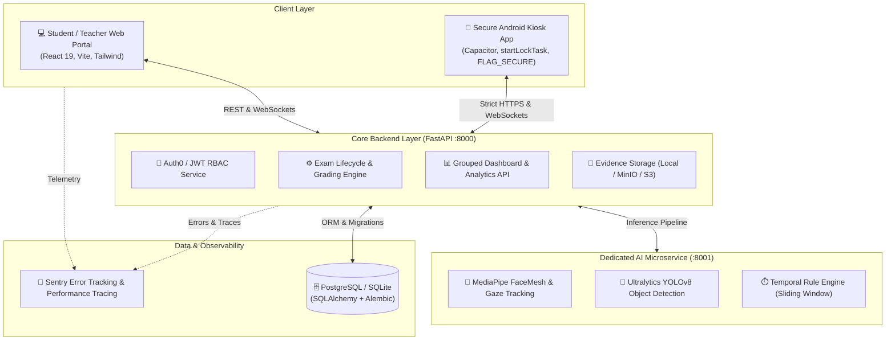

# 🛡️ SmartProctor

<p align="center">
  <strong>Next-Generation AI-Assisted Online Examination & Intelligent Proctoring System</strong>
</p>

<p align="center">
  <a href="https://github.com/chinmay161/SmartProctor/blob/main/LICENSE"></a>
  <a href="https://www.python.org/downloads/release/python-3120/"></a>
  <a href="https://fastapi.tiangolo.com/"></a>
  <a href="https://react.dev/"></a>
  <a href="https://vitejs.dev/"></a>
  <a href="https://tailwindcss.com/"></a>
  <a href="https://developer.android.com/"></a>
  <a href="https://sentry.io/"></a>
</p>

---

## 📌 Overview

**SmartProctor** is an enterprise-ready, end-to-end examination platform designed for educational institutions, certification authorities, and hiring teams. It bridges the gap between remote testing convenience and academic integrity by combining real-time computer vision proctoring (face mesh, gaze tracking, and object detection) with an automated lifecycle engine, role-based access control, and intuitive analytics dashboards.

Whether delivered across modern desktop web browsers or locked down inside dedicated Android kiosk environments, SmartProctor delivers tamper-resistant testing while offering educators real-time live monitoring, violation review workflows, and instant grading.

---

## 🏛️ System Architecture

SmartProctor is structured into decoupled, high-performance services communicating over REST, WebSockets, and asynchronous pipelines:



---

## 💻 Tech Stack

| Domain | Technologies & Libraries | Highlights & Purpose |
| :--- | :--- | :--- |
| **Frontend** | React 19, Vite 6, React Router 7, Tailwind CSS, Lucide Icons | Responsive single-page application with role-protected routing and real-time state management. |
| **Backend API** | FastAPI, Python 3.12, Pydantic v2, Python-Jose | Asynchronous REST and WebSocket signaling server with strict schema validation. |
| **Database & ORM** | PostgreSQL (Production), SQLite (Dev), SQLAlchemy 2.0, Alembic | Fully typed relational models, ACID transactions, and deterministic schema migrations. |
| **AI & Computer Vision** | MediaPipe FaceMesh (`0.10.14`), Ultralytics YOLOv8n, OpenCV, NumPy | Real-time facial landmark detection, phone/book recognition, and temporal anomaly smoothing. |
| **Mobile (Kiosk)** | Android SDK (API 24 to 36), Capacitor, Java / Kotlin | Native hardware screen pinning (`startLockTask`), `FLAG_SECURE`, and cryptographic APK self-updater. |
| **Security & Auth** | Auth0, JWT, Role-Based Access Control (Admin, Teacher, Student) | Centralized role permissioning, token signature validation, and secure session management. |
| **Observability** | Sentry (Python & React SDKs), Structured JSON Logging | Distributed tracing, error aggregation, request correlation IDs, and frontend breadcrumbs. |

---

## ✨ Key Features

### 🛡️ Real-Time Multimodal AI Proctoring
* **Face Mesh & Head Pose Estimation**: Tracks 468+ facial landmarks using MediaPipe to determine head tilt, yaw, and gaze deflection in real time.
* **Unauthorized Object Detection**: Identifies banned materials (mobile phones, books, notes) in the candidate's camera feed using Ultralytics YOLOv8.
* **Temporal Violation Engine**: Uses sliding-window anomaly analysis to prevent false alarms from momentary blinks or brief posture shifts.
* **Evidence Snapshots**: Automatically captures and encrypts timestamped evidence frames stored locally or in S3/MinIO buckets.

### 🎓 Secure Student Exam Portal
* **Distraction-Free Environment**: Enforces fullscreen lockdown, keyboard shortcut suppression, and blur/tab-switch detection.
* **Live Synchronized Timer**: Accurate countdown with automatic background submission upon exam window expiration.
* **Clear Question Navigation**: Bookmark questions, track unanswered items, and receive clean submission confirmations.

### 📊 Teacher Command Center & Analytics
* **Single-Endpoint Dashboard (`GET /teacher/dashboard`)**: Instant overview of exam counts, live sessions, pending disputes, and unreviewed violations in a single cached query without per-exam loops.
* **Live Classroom Monitor**: Real-time heartbeat tracking showing currently connected students and violation alerts.
* **Fair Review & Dispute Resolution**: Sortable violation queues with human-in-the-loop audit actions (`CONFIRMED`, `FALSE_POSITIVE`, `UNSURE`).
* **Automated Scoring & Analytics**: Instant distribution charts, average score calculation, and one-click grade publishing.

### 📱 Android Secure Kiosk Application
* **Hardware Lockout (`startLockTask()`)**: Prevents students from exiting the application, opening status bars, or launching third-party apps during exams.
* **Anti-Screen Capture (`FLAG_SECURE`)**: Blocks device screenshots, screen recorders, and conceals exam data in the recent apps switcher.
* **Android 14+ Screenshot Event Callback**: Real-time violation event signaling when hardware screenshot keys are pressed.
* **Cryptographic Self-Updater**: Background updater with SHA-256 certificate fingerprint verification to prevent tampered or rogue APK installations.

---

## 🚀 Getting Started

### Prerequisites

Ensure you have the following installed on your machine:
* **Node.js**: `20.x` or higher ([Download Node.js](https://nodejs.org/))
* **Python**: `3.12` or higher ([Download Python](https://www.python.org/))
* **Git**: [Download Git](https://git-scm.com/)
* *(Optional for Android builds)*: Android Studio Iguana / Ladybug & JDK 17

---

### Installation & Setup

#### 1. Clone the Repository
```bash
git clone https://github.com/chinmay161/SmartProctor.git
cd SmartProctor
```

#### 2. Configure Environment Files

Create the local configuration files from the provided examples:

##### Backend Configuration (`backend/.env`):
```bash
cp backend/.env.example backend/.env
```
Key variables to adjust in `backend/.env`:
```ini
# Environment
ENVIRONMENT=development
DATABASE_URL=sqlite:///./smartproctor.db

# CORS (include web dev server and Android capacitor localhost)
CORS_ORIGINS=http://localhost:5173,https://localhost

# Authentication (Auth0 or Mock for development)
AUTH0_DOMAIN=your-tenant.auth0.com
AUTH0_API_AUDIENCE=https://smartproctor-api

# Evidence Storage (local or s3)
EVIDENCE_STORAGE=local

# Optional Sentry Observability
SENTRY_DSN=
```

##### Frontend Configuration (`frontend/.env`):
```bash
cp frontend/.env.example frontend/.env
```
Key variables to adjust in `frontend/.env`:
```ini
VITE_API_BASE=http://localhost:8000
VITE_AUTH0_DOMAIN=your-tenant.auth0.com
VITE_AUTH0_CLIENT_ID=your-client-id
VITE_AUTH0_AUDIENCE=https://smartproctor-api
VITE_INFERENCE_MODE=server
```

---

#### 3. Run the AI Worker Microservice
The AI worker runs vision inference models on port `8001`:
```bash
cd ai-worker
python -m venv venv
# On Windows:
.\venv\Scripts\activate
# On Linux/macOS:
source venv/bin/activate

pip install -r requirements.txt
uvicorn main:app --port 8001 --reload
```

#### 4. Run the Backend API Server
The backend handles authentication, database persistence, and exam state machines on port `8000`:
```bash
cd backend
python -m venv venv
# On Windows:
.\venv\Scripts\activate
# On Linux/macOS:
source venv/bin/activate

pip install -r requirements.txt
alembic upgrade head
uvicorn app.main:app --port 8000 --reload
```

#### 5. Run the Frontend Web Portal
Start the modern React 19 development portal on port `5173`:
```bash
cd frontend
npm install
npm run dev
```

Visit **`http://localhost:5173`** in your browser to access the portal.

---

## 📖 Usage & API Examples

### Access Points

* **Student / Teacher Portal**: `http://localhost:5173`
* **FastAPI Interactive Docs (Swagger)**: `http://localhost:8000/docs`
* **AI Worker Interactive Docs**: `http://localhost:8001/docs`

### Teacher Dashboard Overview Endpoint

Teachers and administrators fetch all dashboard metrics in one aggregated call:

```http
GET /teacher/dashboard HTTP/1.1
Host: localhost:8000
Authorization: Bearer <TEACHER_JWT_TOKEN>
```

#### Sample Response:
```json
{
  "counts": {
    "draft": 2,
    "scheduled": 1,
    "active": 1,
    "ended": 8
  },
  "attention": {
    "live_exams": 1,
    "awaiting_grading_total": 4,
    "results_unpublished": 2,
    "unreviewed_violations_total": 5,
    "pending_disputes_total": 1
  },
  "exams": [
    {
      "id": "ex_9b1deb4d",
      "title": "Computer Networks Midterm",
      "effective_status": "ACTIVE",
      "start_time": "2026-11-20T10:00:00Z",
      "end_time": "2026-11-20T12:00:00Z",
      "duration_minutes": 120,
      "results_visible": false,
      "enrolled_count": 45,
      "attempts_started": 42,
      "attempts_submitted": 38,
      "awaiting_grading": 4,
      "violation_count": 3,
      "unreviewed_violation_count": 1,
      "pending_dispute_count": 0,
      "live_students": 4
    }
  ],
  "errors": []
}
```

---

## 🧪 Testing

Run comprehensive automated test suites across all layers of the platform:

```bash
# 1. Backend API & Database Unit / Integration Tests
cd backend
pytest

# 2. Frontend Vitest Suite
cd frontend
npm test

# 3. Android Native Security & In-App Updater Tests
cd frontend/android
./gradlew testDebugUnitTest
```

---

## 📱 SmartProctor Android Kiosk App

The SmartProctor native Android app provides a secure kiosk environment tailored for examination delivery.

### 📥 Download Production APK
Download the latest production release directly from [GitHub Releases](https://github.com/chinmay161/SmartProctor/releases/latest):
* **Release Asset**: `SmartProctor-v1.0.0-release.apk` (or `app-release.apk`)
* **Minimum Android Version**: Android 7.0 (API Level 24)
* **Target Android Version**: Android 16 (API Level 36)

### 🛡️ Native Security & Proctoring Features
* **Kiosk Window Pinning (`startLockTask()`)**: Locks the application into a foreground kiosk session, detecting pinning exits and task switching.
* **Anti-Screen Capture (`FLAG_SECURE`)**: Prevents screenshots, screen recording capture, and conceals window contents in the Android recent apps list.
* **Android 14+ Screenshot Callback Detection**: Real-time violation event signaling when hardware screenshot combinations are triggered.
* **Strict HTTPS Only**: Cleartext HTTP traffic is disabled globally via `network_security_config.xml`.
* **Backup Extraction Protection**: `android:allowBackup="false"` prevents arbitrary extraction of exam state or authentication cache via ADB or cloud backups.

### 🔄 In-App Updater System
* **Cryptographic APK Signature Verification**: Before handing any downloaded package to the Android Package Installer, the app verifies the candidate APK's signing certificate against the installed app's SHA-256 certificate fingerprint. If a signature mismatch or corrupted package is detected, installation is blocked and the candidate file is wiped.
* **ETag HTTP Caching**: Uses `If-None-Match` and `304 Not Modified` headers to eliminate unnecessary data consumption.
* **Frequency Gating**: Background update checks occur at most once every 12 hours (configurable via `UpdateConfig`), while respecting GitHub `X-RateLimit-*` headers without interrupting active exams.

### 🏗️ Building the Android Release APK

```bash
# 1. Compile web assets
cd frontend
npm run build:android

# 2. Assemble release APK using Gradle
cd android
./gradlew assembleRelease
```
The signed APK will be generated at:
`frontend/android/app/build/outputs/apk/release/app-release.apk`

---

## 📄 License

This project is licensed under the **MIT License**. See the [LICENSE](LICENSE) file for complete details.
